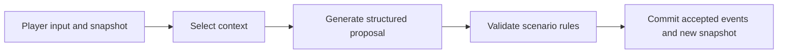
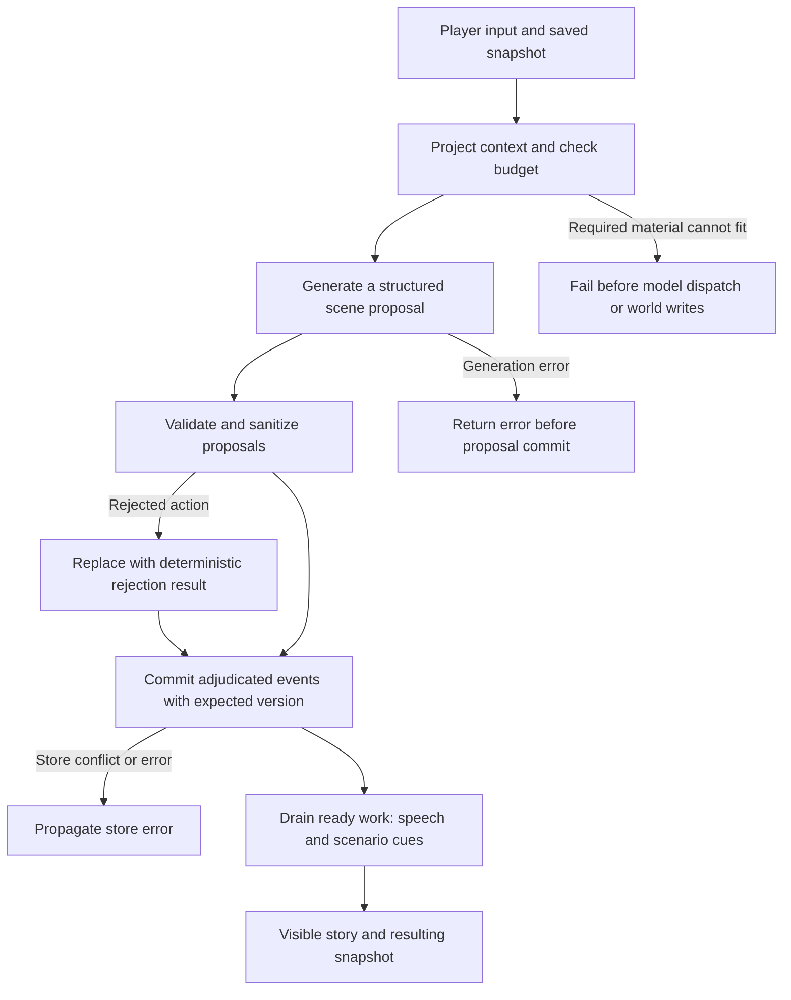
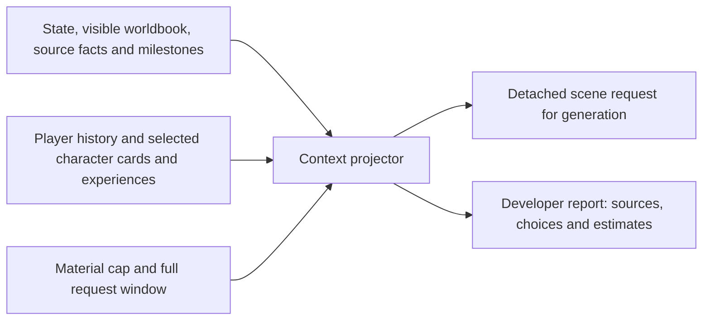

# StoryLoop Harness

[中文](README.md) | **English**

Turn free-form player input into scenes and persistent world state. StoryLoop Harness is an independent Python runtime for developers building narrative applications, CLI stories or generation experiments.

- **Select context:** assemble relevant story material from player and character views.
- **Validate world changes:** check generated proposals against scenario rules before committing accepted events.
- **Inspect generation inputs:** preview requests and reports on sources, selection, clipping and budgets.

[Quick start](#quick-start) · [Harbor scenario](examples/freeform) · [Report an issue](https://github.com/storyloop0/storyloop-harness/issues) · [Player and creator UI: StoryLoop Platform](https://github.com/storyloop0/storyloop-platform)

## See one turn

This is an excerpt of the installed demo's story output for input `Hello`. It uses a deterministic model: no key, provider requests or model service charges. It demonstrates the runtime flow, not live-model narrative quality.

```text
The dockhand coils a rope and waves you toward the arriving boat.

【Dockhand】
The morning boat has arrived.
Snapshot version: 2
```

## Quick start

You need **Python 3.12+** and Git. Run the commands for your system; on macOS / Linux, `python3` must be 3.12 or newer. Success prints the story above and `Snapshot version: 2` in your terminal.

**Windows PowerShell**

```powershell
git clone https://github.com/storyloop0/storyloop-harness.git
cd storyloop-harness
py -3.12 -m venv .venv
.\.venv\Scripts\python.exe -m pip install .
.\.venv\Scripts\python.exe -m storyloop_harness.demo
```

**macOS / Linux**

```sh
git clone https://github.com/storyloop0/storyloop-harness.git
cd storyloop-harness
python3 -m venv .venv
.venv/bin/python -m pip install .
.venv/bin/python -m storyloop_harness.demo
```

Next: edit the story material in the [harbor scenario](examples/freeform), or expand the reference below to supply your own model and store. For a browser interface for players and creators, use [StoryLoop Platform](https://github.com/storyloop0/storyloop-platform).

The installed `storyloop-harness-demo` command (or `python -m storyloop_harness.demo`) loads its own bundled scenario without a checkout examples directory. Temporary saves are removed after the run; pass `--db story.sqlite3` to persist a save, then repeat the same `--turn-id` and `--text` to check replay. Output separates fixture invocations from provider requests (always 0); unchanged replay requires no new events and no fixture invocation. Use the harbor authoring example to edit story material.

## How the runtime works



Generated prose does not automatically become a world fact. Harness handles context, generation, validation and event execution; your application supplies model credentials, storage selection and pricing. `TurnEngine.project_context` lets you inspect requests without model calls or writes.

**Status:** active incubation · MIT. APIs, configuration and saved formats may change without compatibility or migration support. Character views do not guarantee secret isolation; SQLite provides per-commit persistence, while applications own cross-process coordination, and a turn is not guaranteed to be atomic.

## Feedback and contributions

For problems or usage suggestions, open an [Issue](https://github.com/storyloop0/storyloop-harness/issues) with the version or commit, operating system, minimal reproduction and errors with credentials removed. To contribute, start with the harbor example or an existing issue, then describe the behavior change and verification in your PR. Development commands are in the reference below.

<details>
<summary>Developer reference: integration, context budgets and execution boundaries</summary>

In every command below, replace `python` with `.\.venv\Scripts\python.exe` on Windows or `.venv/bin/python` on macOS / Linux so you use the environment installed above. Run from the repository root.

### Save and continue a story

After installation, run these three commands. The second replays the same turn; the third attempts the action again.

```sh
python examples/persistent_story.py --db .venv/storyloop-demo.sqlite3 --turn-id break-1 --text "break the window"
python examples/persistent_story.py --db .venv/storyloop-demo.sqlite3 --turn-id break-1 --text "break the window"
python examples/persistent_story.py --db .venv/storyloop-demo.sqlite3 --turn-id break-2 --text "break the window"
```

The first prints `window_broken: true`; the second keeps the same version with `model_calls: 0`; the third is rejected by the action rule. SQLite preserves world state, history, and pending work. The offline fixture recognizes only this fixed action and `hello`; it demonstrates execution and recovery.

<details>
<summary>Use a live model</summary>

Set `STORY_MODEL_API_KEY`, `STORY_MODEL_NAME`, and `STORY_MODEL_BASE_URL`, then add `--live` to the command with a new turn ID and your own input. This needs an OpenAI-compatible endpoint supporting structured output and incurs provider charges. The example demonstrates credential/model wiring; endpoint compatibility still needs checking.

</details>

### Use the turn API

Run from the repository root after installation:

```python
import asyncio
import sys

from storyloop_harness import ScenarioPackage, TurnEngine, TurnInput
from storyloop_harness.testing import InMemoryGameStore, OfflineModel


async def main():
    package = ScenarioPackage.load("examples/freeform")
    store = InMemoryGameStore()
    package.seed_game(store, "demo")
    engine = TurnEngine(store, package, OfflineModel())
    outcome = await engine.run_turn(
        TurnInput("demo", "Hello", "turn-1", package.version)
    )
    print(outcome.narration)
    print(outcome.snapshot.version)


if __name__ == "__main__":
    sys.stdout.reconfigure(encoding="utf-8")
    asyncio.run(main())
```

To connect a live model, supply a `ModelPort` implementation; the
`generation.CompatibleOpenAIChatModel` adapter uses AgentScope 2.0.9. The caller
supplies credentials and routing. To persist games, use `storage.SQLiteGameStore` or implement `GameStore` and
its expected-version commit contract.

To bound one structured generation, pass a policy when constructing the adapter:

```python
from storyloop_harness.generation import CompatibleOpenAIChatModel, GenerationBudget

model = CompatibleOpenAIChatModel(
    credential=credential, model=model_name,
    generation_budget=GenerationBudget(max_requests=3, timeout_seconds=90),
)
```

The optional policy applies to `generate_structured_output` and calls with `structured_model`; the library default is `None`. It counts completion sends across AgentScope retries and fallback strategies, with no SDK retries on those bounded calls. The deadline starts before formatting and covers waiting, response streaming and validation. Expiry cancels awaited work, while synchronous validation is checked when it returns. One generation is not a whole player turn; HTTP redirects may add transport requests. Ordinary calls and raw SDK use keep their existing retry settings. `GenerationRequestLimitExceeded` and `GenerationTimeout` have fixed messages. The policy does not alter usage collection or billing.

To inspect structured generation attempts, wrap the awaited call with the independent collector:

```python
from storyloop_harness.usage import collect_attempts, summarize_attempt_usage

with collect_attempts() as attempts:
    try:
        response = await model.generate_structured_output(messages, Reply)
    except Exception as exc:
        print(type(exc).__name__)

summary = summarize_attempt_usage(attempts.records)
print(summary.known_input_tokens, summary.known_output_tokens)
print(summary.usage_complete)
```

This records logical attempts for `CompatibleOpenAIChatModel` structured output only; internal SDK HTTP retries do not add records. The immutable summary deduplicates identical attempt identities and groups reported usage by model and task. Known token totals include reported attempts even when generation fails; with no reported usage, they are `None` rather than zero. `usage_complete` describes only the supplied nonempty structured record set: every record must have reported usage and a completed stream. In a failed or cancelled stream, reported usage is the last known count, not necessarily the full cost. This is not a complete provider invoice or whole-turn coverage. Records contain no content or exception messages, are not persisted, and do not change `collect_usage` billing.

### Execution budgets across generations

Import `ExecutionBudget` and `execution_budget_scope` from `storyloop_harness.generation`, then wrap same-task execution with `async with execution_budget_scope(ExecutionBudget(6, 180)):`. This optional scope shares actual compatible-adapter completion sends and a monotonic deadline, including ordinary calls by default; each `GenerationBudget(3, 90)` still applies independently. Controlled requests disable extra SDK retries, and child tasks inheriting a scope cannot send. Synchronous blocking cannot be interrupted precisely. Unscoped Harness calls retain their policy.

Optional `max_reported_tokens` is disabled by default. It sums reported input and output tokens across structured generations, models, retries and fallbacks in one execution, including failed attempts. Cached input is already included:

```python
from storyloop_harness.generation import ExecutionBudget, execution_budget_scope

async with execution_budget_scope(ExecutionBudget(max_reported_tokens=12_000)):
    response = await model.generate_structured_output(messages, Reply)
```

At the threshold, the next send raises `ExecutionTokenLimitExceeded`. With missing, invalid or incomplete usage, the next send raises `ExecutionUsageUnavailable`. No attempt collector is required. Token mode supports structured generation and `__call__(structured_model=...)`; ordinary and direct guarded sends are rejected. A request already sent can exceed the threshold and still return a valid result. This does not guarantee a provider token or cost cap, or change successful usage collection and billing.

### Optional generated-scene recovery

Standalone applications can import `GeneratedSceneRecovery` from `storyloop_harness.advanced` and pass `generated_scene_recovery=GeneratedSceneRecovery(store, "model-config:v1")` to `TurnEngine`. The identity must represent non-secret model configuration; the store must implement the separate snapshot port. A validated scene is saved before the first world commit. Matching input, scenario content, generation configuration and base state can reuse it after restart without projection or model work. Already committed events resume persisted work. Historical success usage is available separately through `engine.generated_scene_snapshot(...).success_usage()` and never enters fresh `model_usage` or attempt records. Without the protection below, a crash before save can repeat a provider call; this does not provide whole-turn atomicity, billing recovery or multiworker ownership. Recovery is disabled by default.

`engine.inspect_generated_scene_recovery(turn)` checks a snapshot without mutation and returns the public frozen `GeneratedSceneRecoveryInspection(snapshot, committed)`, or `None` when absent and no uncertain generation is found as described below. Services holding only an input SHA-256 can use `inspect_generated_scene_recovery_fingerprint(game_id, turn_id, input_hash, scenario_version)`. Both share binding and event-reference validation with execution and perform no projection, model calls or writes. `advanced.snapshot_state_fingerprint(snapshot)` exposes the same world-data fingerprint for external recovery evidence.

Optional `GeneratedSceneRecovery(store, "model-config:v1", protect_uncertain_generation=True)` atomically saves an immutable marker after projection and before ordinary-scene generation. The same store must also implement the separate `advanced.GeneratedSceneGenerationMarkerStore`; SQLiteGameStore and InMemoryGameStore support it. A marker for the same turn without a valid saved scene or committed result makes execution and the read-only checks above raise `advanced.GeneratedSceneUncertain` (`Generated scene outcome is uncertain`). Valid saved results still recover without a model call.

Protection is disabled by default. Errors or cancellation after the marker can block the turn even if the request never reached a provider, requiring application or operator judgment. Markers are never automatically cleared or expired. This protects one ordinary-scene generation and its existing internal retries; it does not prove provider acceptance or charges, provide per-send accounting, guarantee global deduplication or establish worker ownership.

## Inspect and configure the budget

Run from the repository root:

```python
from storyloop_harness import ScenarioPackage, TurnEngine, TurnInput
from storyloop_harness.context import ContextBudget, ContextBudgetExceeded
from storyloop_harness.testing import InMemoryGameStore, OfflineModel

package = ScenarioPackage.load("examples/freeform")  # synthetic scenario
store = InMemoryGameStore()
package.seed_game(store, "inspection")
engine = TurnEngine(store, package, OfflineModel(), context_budget=ContextBudget(
    context_window_tokens=65536, output_tokens=4096,
    safety_margin_tokens=256, max_material_tokens=16000,
))
projection = engine.project_context(
    TurnInput("inspection", "Hello", "inspect-1", package.version)
)
print(projection.report.to_dict())
```

The default limits shown above reserve 4,096 output tokens and 256 safety tokens within a 65,536-token request window, with a separate 16,000-token serialized material cap. Estimates use `utf8-conservative-v1`, a character/UTF-8 heuristic, not exact provider token counts. `scene-projection-v1` includes the system prompt, message framing/escaping, expanded output schema, transport allowance, output reserve and safety margin. The projection estimate selects material; on each model attempt, the AgentScope adapter formats the request once, checks and sends the same detached final request snapshot, and sets a `max_completion_tokens` cap. The check remains heuristic; usage from a successful response does not yet include earlier failed fallback attempts. Custom `ModelPort` implementations must honor the bounded-call contract.

Public rules, source resolutions, player input, authoritative state and a nonempty selected role identity floor are required. If they cannot fit, `ContextBudgetExceeded` carries a report without source prose and fails before model dispatch or world writes. Changed inspection requests are re-estimated during generation. Each AgentScope model attempt is checked again; internal OpenAI SDK HTTP retries reuse the checked detached snapshot. The policy does not account for whole-campaign spend.

### Projection selection reference

The inspected scope includes history after each recipient's checkpoint, the last four player inputs, the last six player observations, visible worldbook entries, public/system source facts and milestone candidates, plus private role material/history for selected responders. Unselected actors' private context and other saves are outside that scope. The engine uses its clock, story program, responder limit and explicit player preference scope.

Select a fixed policy with `TurnEngine(..., context_policy=ContextPolicy.RELEVANT)` after importing `ContextPolicy` from `storyloop_harness.context`. Omitting the argument keeps `ContextPolicy.DEFAULT` (`scene-projection-v1`). `RECENT` uses recent raw experiences only; `RELEVANT` allows more older relevant experiences. Both read all committed history for that recipient and omit checkpoints. `SUMMARY` combines a checkpoint with shorter raw-history windows, falling back to raw history when no checkpoint exists. All four share the same scope protection, budget fitter and authoritative state rules. Reports identify the selected `policy_id`; `testing.project_scene_request` also accepts `context_policy`.

### Character experience checkpoints

Pass an async `checkpoint_summarizer` to `TurnEngine` to check player and character histories after newly committed successful turns. It receives a `CheckpointRequest` imported from `storyloop_harness.context`, with the save, actor, scenario identity, previous summary and new source entries, and returns a new summary of at most 1200 characters. The summarizer should preserve important earlier information and source clues. By default, at least 16 new entries trigger a checkpoint while at least eight recent raw entries, including their complete version groups, remain. Without a summarizer, the engine makes no extra model call.

SQLite records the actor, scenario identity, covered version and source IDs for the latest batch; original events and observations remain. A summary failure does not undo the committed turn or advance the cursor, so a new turn can retry. Replaying the same turn does not summarize again. Once the cursor advances, an observation for that actor cannot be added to a covered event; record later observations under a new event. Summaries cache character experiences rather than authoritative world state. The shared model may still see selected characters' private context. Existing SQLite files are not migrated automatically; applications implementing `GameStore` must update their checkpoint storage for this contract.

`selected` and `truncated` are independent. `omission_reason` records rank/item limits, field clipping (`field_limit`), or material/window trimming. Source facts and milestone cues yield before recent experiences; prompt omission does not change milestone eligibility.

`testing.project_scene_request(store, package, game_id, player_text, context_budget=ContextBudget())` returns only a detached request using the same projector; optional arguments include `clock`, `program` and `max_responders`.


## Small narrative experiments

From the repository root, after installing the harness:

```sh
python -m examples.evaluation --output result.json
python -m examples.policy_comparison --output policy-comparison.json
python -m examples.policy_comparison --case old-clue --policy history-recent-v1 --output selected-comparison.json
python -m examples.policy_comparison --pricing synthetic-pricing.json --case old-clue --policy history-recent-v1 --output priced-comparison.json
python -m examples.policy_comparison --suite narrative --output narrative-metrics.json
python -m examples.policy_comparison --suite narrative --review-output review.json --output metrics.json
# Optional native Langfuse runner (SDK 4.17.0):
python -m pip install -e '.[evaluation]'
python -m examples.evaluation --langfuse --output result.json
```

- Default execution needs no keys or network. Two isolated SQLite cases check clue retention, projection scope, private-field placement, authored state effects and replay. Failed checks or task/evaluator errors exit 1; JSON includes versions, policy/budget, timing and usage, with cost unknown without pricing.
- The default `contracts` policy comparison runs three fixed authored action cases against four policies, using an isolated SQLite save and the same deterministic model fixture for each pair. Its JSON records source IDs, clue checks, estimated request tokens, projection/turn timings and authoritative results. An accepted authored action uses canonical author text for the final narration. The separate `narrative` suite runs three free speech cases against the same four policies; it tests actual player-visible speech without assuming narration or event hashes match across policies. Both suites test runtime contracts only. The fixture reports no provider tokens, so cost is `null` even with pricing. These offline structural results do not establish real-model narrative quality, provider billing or Langfuse ingestion. Platform currently continues using Harness's default policy.

  `--review-output review.json` is an explicit local content export for the `narrative` suite only. The ordinary metrics report omits player text, reference facts, narration and ratings by default. The review packet contains the first final player-visible narration, each case's public synthetic reference facts, selected coverage and safe contract, token, cost and timing evidence. Its `run_id` matches the metrics report and each metric row; `narration_sha256` hashes the exact UTF-8 narration. A failed preparation has `null` narration and `not_available` status. A later replay or cleanup failure retains the first narration with failed checks. The output may contain player or story text, including generated content; inspect it before sharing. Neither flag enables paid calls. A separate `--live` with one explicit case and policy is required for provider use.

  Each item starts with `status: unreviewed`, an empty reviewer, and `null` scores for factual grounding, response to the player's request, and coherence. For each dimension, enter 0 when it does not meet the criterion, 1 when it partly meets it, or 2 when it meets it; record a short quoted excerpt or reason in `evidence_note` and identify the reviewer. For factual grounding, check claims against the public reference facts and whether missing context is admitted. For request response, check whether the reply addresses the player's question. For coherence, check whether the final speech reads consistently and clearly. `null` means not reviewed, never zero. The tool does not import scores, average them, rank policies, run an automatic judge or upload the packet. Coverage names selected, completed and excluded case/policy pairs; compare only selected pairs and keep unknown costs unknown. No real quality improvement is claimed from these fixtures.

  Optional `--pricing` reads a local JSON snapshot and estimates only reported attempt usage. It does not enable paid calls by itself. These are **synthetic rates for testing, not provider quotes**:

  ```json
  {"schema_version":1,"pricing_id":"synthetic-example","as_of":"2026-10-18","currency":"USD","models":{"offline-test":{"input_per_million":"1","output_per_million":"2","cached_input_per_million":"0.5"}}}
  ```

  `schema_version` must be 1; `pricing_id` is nonempty, `as_of` is a `YYYY-MM-DD` date, and `currency` is three uppercase letters. `models` matches the recorded model name exactly, without aliases. All three per-million-token rates must be nonnegative finite plain decimal strings; `"0"` is valid. Input tokens already include cached input. The estimate is `((input_tokens - cached_input_tokens) × input_per_million + cached_input_tokens × cached_input_per_million + output_tokens × output_per_million) / 1000000`. When the adapter receives no cache information, it follows the existing cache-as-zero convention. Amounts are exact plain decimal strings, without currency conversion, points, application multipliers, tax, or cent rounding.

  Each row's `known_cost` sums reported priced usage from first-run attempts, including complete failures, cancellations, and fallbacks. `cost` is non-null only when usage is complete and every reported model is priced. An explicitly reported zero-token usage or zero rate can yield `"0"`; absent reported priced usage stays `null`, not zero. `cost_currency` comes from the snapshot. `cost_status` is `estimated`, `unknown`, or the unchanged `unknown: no pricing supplied` without pricing. `cost_reasons` uses `no_pricing`, `no_attempts`, `missing_usage`, `invalid_usage`, `incomplete_stream`, and `unpriced_model`; `unpriced_models` is sorted and deduplicated. Missing prices do not change behavior checks or `passed`. Replay never adds cost again.

  `metadata.pricing` contains the normalized full snapshot and its canonical-JSON SHA-256 hash. Rates freeze before model construction for the run, so later file changes do not affect the report. Snapshot data is report-visible; include only pricing information you can disclose. This is an estimate of reported tokens captured by the experiment, not a provider invoice or hard budget ceiling. There is no matrix cost total or ranking of policy quality by cost.

  The report names `preparation_seconds`, `projection_seconds`, `generation_seconds`, `turn_seconds` and `replay_seconds`; `metadata.timing_version` is `policy-phases-v1`. Preparation runs from task entry before temporary storage to the first turn, including setup, seeded history, metadata and the separately timed preflight projection. Generation measures the awaited adapter call, including request capture, retry/fallback and stream consumption; it is inside turn time. Turn ends before attempt summaries, result checks and storage close. Replay starts after the original store closes and includes reopening the same SQLite database, constructing a new engine, replaying the same input and closing that store; comparisons follow. These monotonic seconds overlap and must not be summed. They are not provider-only inference, first-token latency, process startup or total task time; report writing, temporary-directory removal and model-client close are excluded.

  `timing_status` records `not_started`, `completed`, `failed` or `cancelled` per phase. Unstarted durations are `null`; started phases retain elapsed time on failure/cancellation. Later evidence/cleanup errors fail the row without rewriting completed statuses. Replay uses a separate model that refuses generation, requiring zero new calls, events, attempts, usage and version change, plus identical state/narration. First-generation usage stays separate. Fixture provider usage and cost remain unknown; timings do not establish quality or price improvements.
- Use `--case` and `--policy` to select a subset; coverage distinguishes selected, completed and excluded pairs. `--live` requires exactly one explicit case and policy, applies 3 requests/90 seconds per generation, and retains known attempt usage on success, failure or cancellation. Matching prices allow an estimate. Cancellation writes partial evidence and exits 130; unfinished pairs stay incomplete. The live entry point has only been verified with offline SDK transports.
- `--langfuse` writes traces/scores via the [native experiment runner](https://langfuse.com/docs/evaluation/experiments/experiments-via-sdk); set `LANGFUSE_PUBLIC_KEY`, `LANGFUSE_SECRET_KEY` and optionally `LANGFUSE_BASE_URL`. Server ingestion is reported as unverified.
- `--live` calls a real provider and incurs charges; set `STORY_MODEL_API_KEY`, `STORY_MODEL_NAME`, `STORY_MODEL_BASE_URL`. Fixtures establish runtime contracts, not narrative quality or character secrecy in shared model context. Edit the task's default `ContextBudget` for small budget comparisons.

## Integration reference

| Surface | Purpose |
| --- | --- |
| Top-level package | `ScenarioPackage`, `TurnEngine`, `TurnInput`, `TurnOutcome`, `GameStore`, `ModelPort`, `CampaignContext` |
| `contracts`, `ports` | Turn data and injected model/store/campaign protocols |
| `context` | `ContextPolicy`, `ContextBudget`, `ContextProjection`, `ProjectionReport`, `MaterialDecision`, `ContextBudgetExceeded` |
| `advanced` | Event, work and story-clock contracts |
| `generation` | Structured model transport, formatting and action suggestions |
| `telemetry`, `usage` | Tracing and scoped token usage, without pricing policy |
| `storage` | Standard-library SQLite persistence with reopen and expected-version commits |
| `testing` | In-memory store, offline model and detached request inspection |

`run_turn` takes a `TurnInput`, optional progress and campaign time bounds. `run_ready_work` drains supported queued work. `TurnOutcome` includes visible output, a snapshot, events committed by that invocation, model usage, and `remaining_work_ids` for ready work left at the step limit. Internal module paths are not extension APIs.

## Current limits and development

- Legacy saves with pending `npc_reply` work are rejected before generation or world writes; recreate them.
- The SQLite adapter provides per-commit transactions and version conflict checks; applications own cross-process task claims and conflict retries.
- Saved-turn replay and expected-version commits do not establish end-to-end billing recovery or distributed execution guarantees.
- Real-model quality/cost comparisons, further long-session memory validation and stronger execution recovery remain development directions.

```sh
python -m pip install -e '.[test,evaluation]' build
python -m pytest tests -q
python -m build --wheel
```

CI also installs a built wheel outside the checkout and runs the offline example. Deterministic tests do not establish live-model narrative quality.

## How a turn works



An ordinary `single_call` turn uses one structured scene generation stage, followed by deterministic work. Transport retries and other scheduled generation tasks can make additional model requests. Character replies are generated together and delivered through `single_npc_reply` work; each character does not run a ReAct loop.

Authored actions are adjudicated against scenario rules and use the authored result as canonical scene prose. Rejections replace prose and discard speculative consequences. Open actions can only change declared mutable fields. Eligible numeric status changes commit with the player event and are not reapplied on replay; the application owns account billing. Free-form generated text is not guaranteed factually consistent. Store errors and later work failures need caller handling: the whole turn is not atomic, and failure before its first commit can require another model call.

## Context you can inspect



`TurnEngine.project_context` synchronously previews the ordinary scene request without model calls or writes. Character views have distinct histories and selection rules, but the shared model sees multiple character contexts: this is not hard secret isolation.

The detached request contains story material. Its immutable report records source IDs, owners, state/checkpoint versions, fields, selection/clipping reasons and size estimates without source prose. Keep both developer-side. Reports are absent from player turn output and stored story events; default telemetry records aggregate counts and estimates.


</details>

## License

[MIT](LICENSE).
