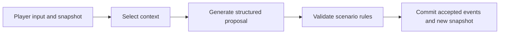
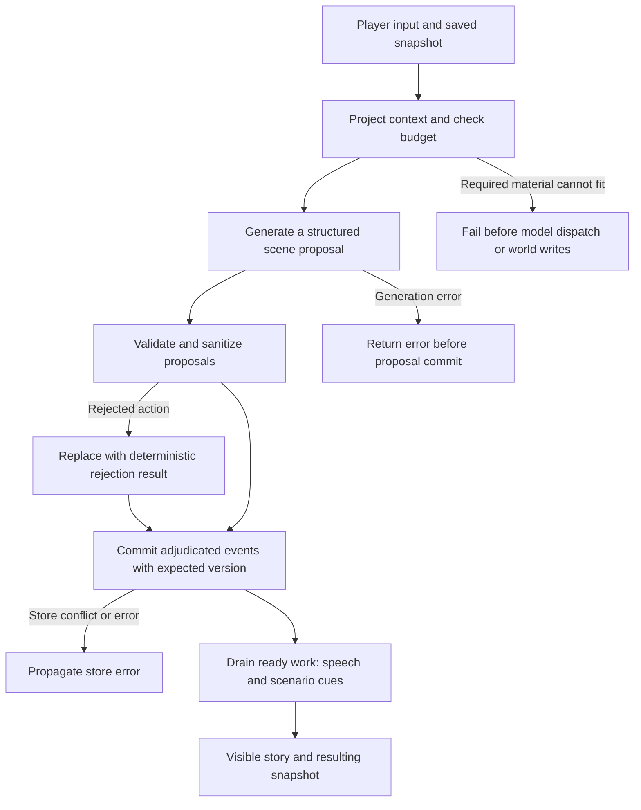
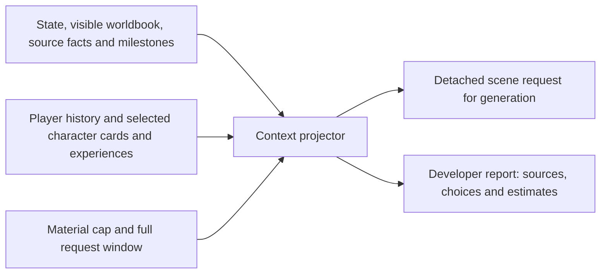

# StoryLoop Harness

[中文](README.md) | **English**

Turn free-form player input into scenes and persistent world state. StoryLoop Harness is an independent Python runtime for developers building narrative applications, CLI stories or generation experiments.

- **Select context:** assemble relevant story material from player and character views.
- **Validate world changes:** check generated proposals against scenario rules before committing accepted events.
- **Inspect generation inputs:** preview requests and reports on sources, selection, clipping and budgets.

[Quick start](#quick-start) · [Harbor scenario](examples/freeform) · [Report an issue](https://github.com/storyloop0/storyloop-harness/issues) · [Player and creator UI: StoryLoop Platform](https://github.com/storyloop0/storyloop-platform)

## See one turn

This is the actual terminal output of `examples/offline_turn.py` for input `Hello`. It uses a deterministic model: no key, provider requests or model service charges. It demonstrates the runtime flow, not live-model narrative quality. The character label is preserved as printed.

```text
The dockhand coils a rope and waves you toward the arriving boat.

【码头工】
The morning boat has arrived.
Snapshot version: 2
```

## Quick start

You need **Python 3.12+** and Git. Run the commands for your system; on macOS / Linux, `python3` must be 3.12 or newer. Success prints the story above and `Snapshot version: 2` in your terminal.

**Windows PowerShell**

```powershell
git clone https://github.com/storyloop0/storyloop-harness.git
cd storyloop-harness
py -3.12 -m venv .venv
.\.venv\Scripts\python.exe -m pip install .
.\.venv\Scripts\python.exe examples/offline_turn.py
```

**macOS / Linux**

```sh
git clone https://github.com/storyloop0/storyloop-harness.git
cd storyloop-harness
python3 -m venv .venv
.venv/bin/python -m pip install .
.venv/bin/python examples/offline_turn.py
```

Next: edit the story material in the [harbor scenario](examples/freeform), or expand the reference below to supply your own model and store. For a browser interface for players and creators, use [StoryLoop Platform](https://github.com/storyloop0/storyloop-platform).

## How the runtime works



Generated prose does not automatically become a world fact. Harness handles context, generation, validation and event execution; your application supplies model credentials, storage selection and pricing. `TurnEngine.project_context` lets you inspect requests without model calls or writes.

**Status:** active incubation · MIT. APIs, configuration and saved formats may change without compatibility or migration support. Character views do not guarantee secret isolation; SQLite provides per-commit persistence, while applications own cross-process coordination, and a turn is not guaranteed to be atomic.

## Feedback and contributions

For problems or usage suggestions, open an [Issue](https://github.com/storyloop0/storyloop-harness/issues) with the version or commit, operating system, minimal reproduction and errors with credentials removed. To contribute, start with the harbor example or an existing issue, then describe the behavior change and verification in your PR. Development commands are in the reference below.

<details>
<summary>Developer reference: integration, context budgets and execution boundaries</summary>

In every command below, replace `python` with `.\.venv\Scripts\python.exe` on Windows or `.venv/bin/python` on macOS / Linux so you use the environment installed above. Run from the repository root.

### Save and continue a story

After installation, run these three commands. The second replays the same turn; the third attempts the action again.

```sh
python examples/persistent_story.py --db .venv/storyloop-demo.sqlite3 --turn-id break-1 --text "break the window"
python examples/persistent_story.py --db .venv/storyloop-demo.sqlite3 --turn-id break-1 --text "break the window"
python examples/persistent_story.py --db .venv/storyloop-demo.sqlite3 --turn-id break-2 --text "break the window"
```

The first prints `window_broken: true`; the second keeps the same version with `model_calls: 0`; the third is rejected by the action rule. SQLite preserves world state, history, and pending work. The offline fixture recognizes only this fixed action and `hello`; it demonstrates execution and recovery.

<details>
<summary>Use a live model</summary>

Set `STORY_MODEL_API_KEY`, `STORY_MODEL_NAME`, and `STORY_MODEL_BASE_URL`, then add `--live` to the command with a new turn ID and your own input. This needs an OpenAI-compatible endpoint supporting structured output and incurs provider charges. The example demonstrates credential/model wiring; endpoint compatibility still needs checking.

</details>

### Use the turn API

Run from the repository root after installation:

```python
import asyncio
import sys

from storyloop_harness import ScenarioPackage, TurnEngine, TurnInput
from storyloop_harness.testing import InMemoryGameStore, OfflineModel


async def main():
    package = ScenarioPackage.load("examples/freeform")
    store = InMemoryGameStore()
    package.seed_game(store, "demo")
    engine = TurnEngine(store, package, OfflineModel())
    outcome = await engine.run_turn(
        TurnInput("demo", "Hello", "turn-1", package.version)
    )
    print(outcome.narration)
    print(outcome.snapshot.version)


if __name__ == "__main__":
    sys.stdout.reconfigure(encoding="utf-8")
    asyncio.run(main())
```

To connect a live model, supply a `ModelPort` implementation; the
`generation.CompatibleOpenAIChatModel` adapter uses AgentScope 2.0.9. The caller
supplies credentials and routing. To persist games, use `storage.SQLiteGameStore` or implement `GameStore` and
its expected-version commit contract.

## Inspect and configure the budget

Run from the repository root:

```python
from storyloop_harness import ScenarioPackage, TurnEngine, TurnInput
from storyloop_harness.context import ContextBudget, ContextBudgetExceeded
from storyloop_harness.testing import InMemoryGameStore, OfflineModel

package = ScenarioPackage.load("examples/freeform")  # synthetic scenario
store = InMemoryGameStore()
package.seed_game(store, "inspection")
engine = TurnEngine(store, package, OfflineModel(), context_budget=ContextBudget(
    context_window_tokens=65536, output_tokens=4096,
    safety_margin_tokens=256, max_material_tokens=16000,
))
projection = engine.project_context(
    TurnInput("inspection", "Hello", "inspect-1", package.version)
)
print(projection.report.to_dict())
```

The default limits shown above reserve 4,096 output tokens and 256 safety tokens within a 65,536-token request window, with a separate 16,000-token serialized material cap. Estimates use `utf8-conservative-v1`, a character/UTF-8 heuristic, not exact provider token counts. `scene-projection-v1` includes the system prompt, message framing/escaping, expanded output schema, transport allowance, output reserve and safety margin. The AgentScope adapter checks the SDK-formatted envelope before HTTP and sends one effective `max_completion_tokens` cap. Custom `ModelPort` implementations must honor the bounded-call contract.

Public rules, source resolutions, player input, authoritative state and a nonempty selected role identity floor are required. If they cannot fit, `ContextBudgetExceeded` carries a report without source prose and fails before model dispatch or world writes. Changed inspection requests are re-estimated during generation. The policy applies to ordinary scene requests and each transport attempt, not whole-campaign spend.

### Projection selection reference

The inspected scope includes history after each recipient's checkpoint, the last four player inputs, the last six player observations, visible worldbook entries, public/system source facts and milestone candidates, plus private role material/history for selected responders. Unselected actors' private context and other saves are outside that scope. The engine uses its clock, story program, responder limit and explicit player preference scope.

`selected` and `truncated` are independent. `omission_reason` records rank/item limits, field clipping (`field_limit`), or material/window trimming. Source facts and milestone cues yield before recent experiences; prompt omission does not change milestone eligibility.

`testing.project_scene_request(store, package, game_id, player_text, context_budget=ContextBudget())` returns only a detached request using the same projector; optional arguments include `clock`, `program` and `max_responders`.


## Small narrative experiments

From the repository root, after installing the harness:

```sh
python -m examples.evaluation --output result.json
# Optional native Langfuse runner (SDK 4.17.0):
python -m pip install -e '.[evaluation]'
python -m examples.evaluation --langfuse --output result.json
```

- Default execution needs no keys or network. Two isolated SQLite cases check clue retention, projection scope, private-field placement, authored state effects and replay. Failed checks or task/evaluator errors exit 1; JSON includes versions, policy/budget, timing and usage, with cost unknown without pricing.
- `--langfuse` writes traces/scores via the [native experiment runner](https://langfuse.com/docs/evaluation/experiments/experiments-via-sdk); set `LANGFUSE_PUBLIC_KEY`, `LANGFUSE_SECRET_KEY` and optionally `LANGFUSE_BASE_URL`. Server ingestion is reported as unverified.
- `--live` calls a real provider and incurs charges; set `STORY_MODEL_API_KEY`, `STORY_MODEL_NAME`, `STORY_MODEL_BASE_URL`. Fixtures establish runtime contracts, not narrative quality or character secrecy in shared model context. Edit the task's default `ContextBudget` for small budget comparisons.

## Integration reference

| Surface | Purpose |
| --- | --- |
| Top-level package | `ScenarioPackage`, `TurnEngine`, `TurnInput`, `TurnOutcome`, `GameStore`, `ModelPort`, `CampaignContext` |
| `contracts`, `ports` | Turn data and injected model/store/campaign protocols |
| `context` | `ContextBudget`, `ContextProjection`, `ProjectionReport`, `MaterialDecision`, `ContextBudgetExceeded` |
| `advanced` | Event, work and story-clock contracts |
| `generation` | Structured model transport, formatting and action suggestions |
| `telemetry`, `usage` | Tracing and scoped token usage, without pricing policy |
| `storage` | Standard-library SQLite persistence with reopen and expected-version commits |
| `testing` | In-memory store, offline model and detached request inspection |

`run_turn` takes a `TurnInput`, optional progress and campaign time bounds. `run_ready_work` drains supported queued work. `TurnOutcome` includes visible output, a snapshot, events committed by that invocation, model usage, and `remaining_work_ids` for ready work left at the step limit. Internal module paths are not extension APIs.

## Current limits and development

- Legacy saves with pending `npc_reply` work are rejected before generation or world writes; recreate them.
- The SQLite adapter provides per-commit transactions and version conflict checks; applications own cross-process task claims and conflict retries.
- Saved-turn replay and expected-version commits do not establish end-to-end billing recovery or distributed execution guarantees.
- Long-session memory, reproducible quality/cost comparisons and stronger execution recovery remain development directions.

```sh
python -m pip install -e '.[test,evaluation]' build
python -m pytest tests -q
python -m build --wheel
```

CI also installs a built wheel outside the checkout and runs the offline example. Deterministic tests do not establish live-model narrative quality.

## How a turn works



An ordinary `single_call` turn uses one structured scene generation stage, followed by deterministic work. Transport retries and other scheduled generation tasks can make additional model requests. Character replies are generated together and delivered through `single_npc_reply` work; each character does not run a ReAct loop.

Authored actions are adjudicated against scenario rules and use the authored result as canonical scene prose. Rejections replace prose and discard speculative consequences. Open actions can only change declared mutable fields. Eligible numeric status changes commit with the player event and are not reapplied on replay; the application owns account billing. Free-form generated text is not guaranteed factually consistent. Store errors and later work failures need caller handling: the whole turn is not atomic, and failure before its first commit can require another model call.

## Context you can inspect



`TurnEngine.project_context` synchronously previews the ordinary scene request without model calls or writes. Character views have distinct histories and selection rules, but the shared model sees multiple character contexts: this is not hard secret isolation.

The detached request contains story material. Its immutable report records source IDs, owners, state/checkpoint versions, fields, selection/clipping reasons and size estimates without source prose. Keep both developer-side. Reports are absent from player turn output and stored story events; default telemetry records aggregate counts and estimates.


</details>

## License

[MIT](LICENSE).
