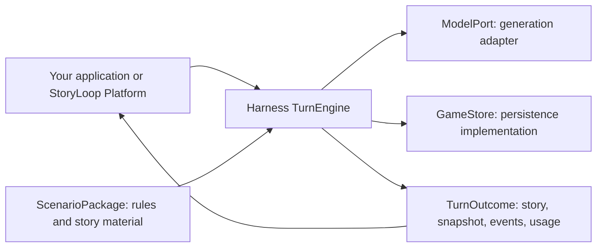
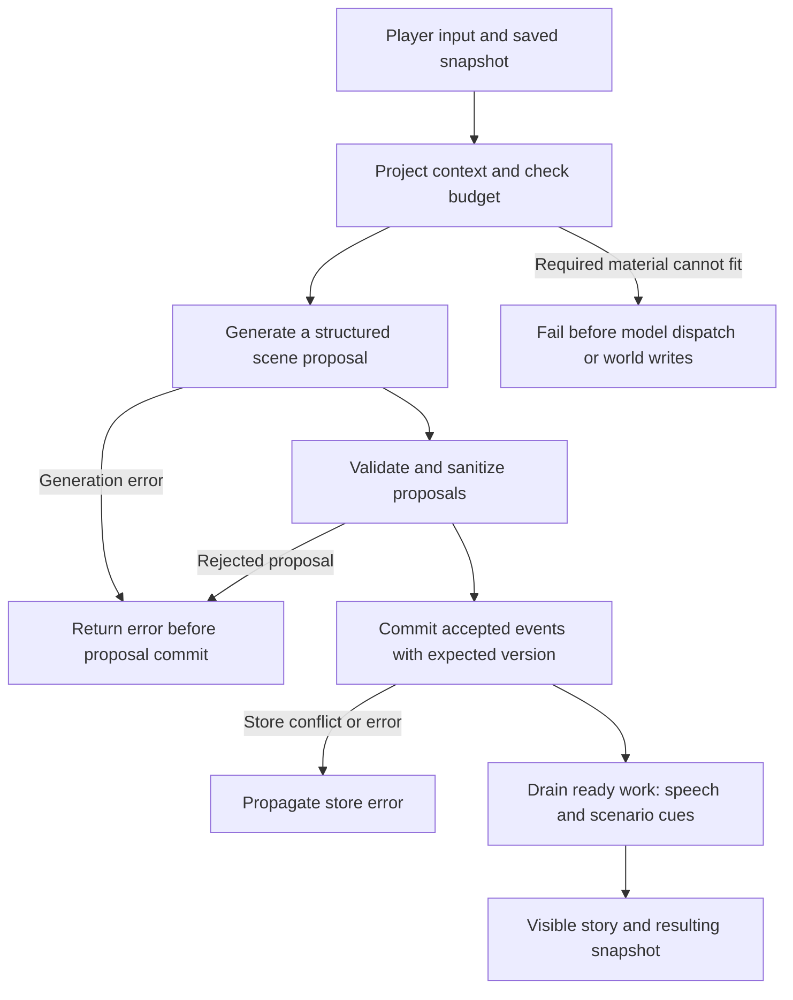
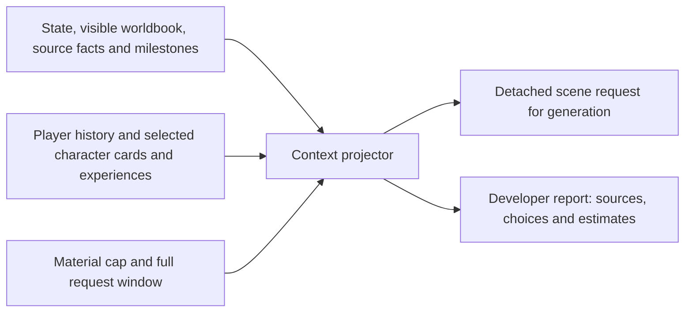

# StoryLoop Harness

[中文](README.md) | **English**

A Python runtime for interactive stories with persistent world facts and character-specific views. It helps developers turn free-form player input into a scene, validated events and a new state snapshot.

For example, a player at a harbor can ask a dockhand a question or try to break a shop window. The runtime assembles the relevant context, asks a model for a structured proposal, checks scenario rules and commits accepted effects. The next turn reads the resulting world state; generated prose alone does not make a proposed effect true. This harbor scenario is included in [examples/freeform](examples/freeform).

**Status:** active incubation · Python 3.12+ · MIT. APIs, configuration and saved formats may change without backward compatibility or migration support.

## Where it fits

Use Harness to build your own narrative application, CLI or experiments by supplying a model and store. [StoryLoop Platform](https://github.com/storyloop0/storyloop-platform) is the companion player/creator application: it owns the frontend, accounts, model routing, billing, SQL storage and deployment.



Harness owns context projection, structured generation, scenario validation and event execution. The caller owns credentials, durable storage, request ownership and pricing. The bundled in-memory store and deterministic model let you explore these boundaries without a model key.

## How a turn works



An ordinary `single_call` turn uses one structured scene generation stage, followed by deterministic work. Transport retries and other scheduled generation tasks can make additional model requests. Character replies are generated together and delivered through `single_npc_reply` work; each character does not run a ReAct loop.

Validation can filter targets, replies and milestones, or replace invalid open-action effects with an unconfirmed attempt. Authored action rules adjudicate their own effects. Status changes remain proposals exposed through `proposed_status` for application settlement. A store error or later work failure needs caller handling: the entire turn is not promised to be one atomic transaction.

## Context you can inspect



`TurnEngine.project_context` synchronously previews the ordinary scene request without model calls or writes. Character views have distinct histories and selection rules, but the shared model sees multiple character contexts: this is not hard secret isolation.

The detached request contains story material. Its immutable report records source IDs, owners, state/checkpoint versions, fields, selection/clipping reasons and size estimates without source prose. Keep both developer-side. Reports are absent from player turn output and stored story events; default telemetry records aggregate counts and estimates.

## Quick start: no model key required

Clone this repository and install it in a virtual environment:

```sh
git clone https://github.com/storyloop0/storyloop-harness.git
cd storyloop-harness
python -m venv .venv
# macOS / Linux:
. .venv/bin/activate
# Windows PowerShell: .\.venv\Scripts\Activate.ps1
python -m pip install .
python examples/offline_turn.py
```

Use a Python 3.12+ interpreter for `python`. The example uses a bundled synthetic
scenario, an in-memory store and a deterministic model. It makes no provider
requests and prints the story plus the resulting snapshot version.

### Use the turn API

Run from the repository root after installation:

```python
import asyncio
import sys

from storyloop_harness import ScenarioPackage, TurnEngine, TurnInput
from storyloop_harness.testing import InMemoryGameStore, OfflineModel


async def main():
    package = ScenarioPackage.load("examples/freeform")
    store = InMemoryGameStore()
    package.seed_game(store, "demo")
    engine = TurnEngine(store, package, OfflineModel())
    outcome = await engine.run_turn(
        TurnInput("demo", "Hello", "turn-1", package.version)
    )
    print(outcome.narration)
    print(outcome.snapshot.version)


if __name__ == "__main__":
    sys.stdout.reconfigure(encoding="utf-8")
    asyncio.run(main())
```

To connect a live model, supply a `ModelPort` implementation; the
`generation.CompatibleOpenAIChatModel` adapter uses AgentScope 2.0.9. The caller
supplies credentials and routing. To persist games, implement `GameStore` and
its expected-version commit contract.

## Inspect and configure the budget

Run from the repository root:

```python
from storyloop_harness import ScenarioPackage, TurnEngine, TurnInput
from storyloop_harness.context import ContextBudget, ContextBudgetExceeded
from storyloop_harness.testing import InMemoryGameStore, OfflineModel

package = ScenarioPackage.load("examples/freeform")  # synthetic scenario
store = InMemoryGameStore()
package.seed_game(store, "inspection")
engine = TurnEngine(store, package, OfflineModel(), context_budget=ContextBudget(
    context_window_tokens=65536, output_tokens=4096,
    safety_margin_tokens=256, max_material_tokens=16000,
))
projection = engine.project_context(
    TurnInput("inspection", "Hello", "inspect-1", package.version)
)
print(projection.report.to_dict())
```

The default limits shown above reserve 4,096 output tokens and 256 safety tokens within a 65,536-token request window, with a separate 16,000-token serialized material cap. Estimates use `utf8-conservative-v1`, a character/UTF-8 heuristic, not exact provider token counts. `scene-projection-v1` includes the system prompt, message framing/escaping, expanded output schema, transport allowance, output reserve and safety margin. The AgentScope adapter checks the SDK-formatted envelope before HTTP and sends one effective `max_completion_tokens` cap. Custom `ModelPort` implementations must honor the bounded-call contract.

Public rules, source resolutions, player input, authoritative state and a nonempty selected role identity floor are required. If they cannot fit, `ContextBudgetExceeded` carries a report without source prose and fails before model dispatch or world writes. Changed inspection requests are re-estimated during generation. The policy applies to ordinary scene requests and each transport attempt, not whole-campaign spend.

<details>
<summary>Projection selection reference</summary>

The inspected scope includes history after each recipient's checkpoint, the last four player inputs, the last six player observations, visible worldbook entries, public/system source facts and milestone candidates, plus private role material/history for selected responders. Unselected actors' private context and other saves are outside that scope. The engine uses its clock, story program, responder limit and explicit player preference scope.

`selected` and `truncated` are independent. `omission_reason` records rank/item limits, field clipping (`field_limit`), or material/window trimming. Source facts and milestone cues yield before recent experiences; prompt omission does not change milestone eligibility.

`testing.project_scene_request(store, package, game_id, player_text, context_budget=ContextBudget())` returns only a detached request using the same projector; optional arguments include `clock`, `program` and `max_responders`.

</details>

## Integration reference

| Surface | Purpose |
| --- | --- |
| Top-level package | `ScenarioPackage`, `TurnEngine`, `TurnInput`, `TurnOutcome`, `GameStore`, `ModelPort`, `CampaignContext` |
| `contracts`, `ports` | Turn data and injected model/store/campaign protocols |
| `context` | `ContextBudget`, `ContextProjection`, `ProjectionReport`, `MaterialDecision`, `ContextBudgetExceeded` |
| `advanced` | Event, work and story-clock contracts |
| `generation` | Structured model transport, formatting and action suggestions |
| `telemetry`, `usage` | Tracing and scoped token usage, without pricing policy |
| `testing` | In-memory store, offline model and detached request inspection |

`run_turn` takes a `TurnInput`, optional progress and campaign time bounds. `run_ready_work` drains supported queued work. `TurnOutcome` includes visible output, a snapshot, events committed by that invocation and model usage. Internal module paths are not extension APIs.

## Current limits and development

- Legacy saves with pending `npc_reply` work are rejected before generation or world writes; recreate them.
- Durable persistence and cross-process coordination require a caller-supplied store and application implementation.
- Saved-turn replay and expected-version commits do not establish end-to-end billing recovery or distributed execution guarantees.
- Long-session memory, reproducible quality/cost comparisons and stronger execution recovery remain development directions.

```sh
python -m pip install -e '.[test]' build
python -m pytest tests -q
python -m build --wheel
```

CI also installs a built wheel outside the checkout and runs the offline example. Deterministic tests do not establish live-model narrative quality.

## License

[MIT](LICENSE).
