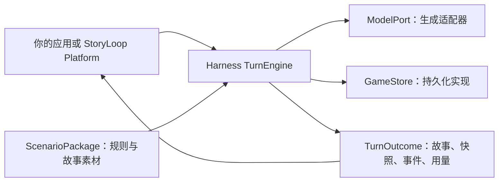
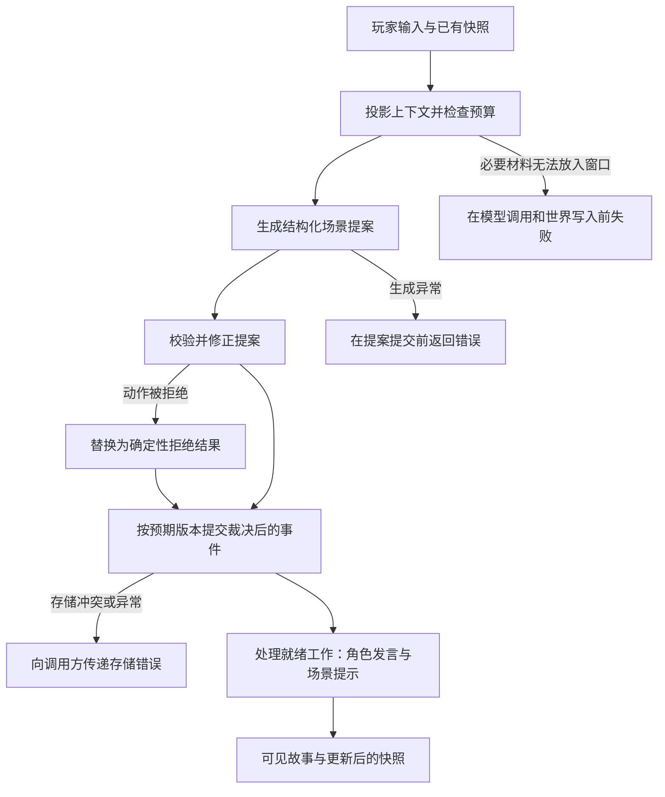
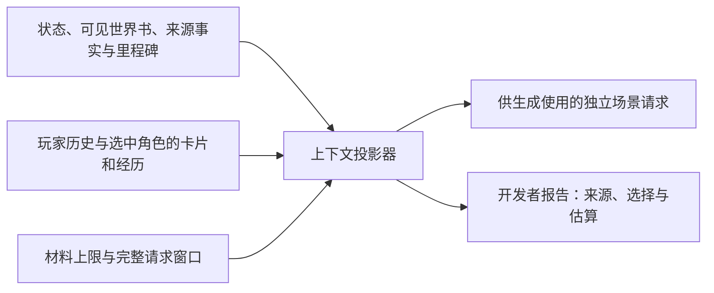

# StoryLoop Harness

**中文** | [English](README.en.md)

用于互动叙事的 Python 运行时，维护持续变化的世界事实与角色各自的信息视角。开发者可以把玩家的自由输入转成场景叙述、经过校验的事件和新的状态快照。

例如，玩家来到港口，可以向码头工提问，也可以尝试打破店铺橱窗。运行时先组装相关上下文，让模型给出结构化提案，再按剧本规则检查并提交获准的状态变化。下一回合读取更新后的世界；模型写出一段叙述，并不意味着提议的变化已经成为事实。仓库包含这个[港口示例](examples/freeform)。

**状态：** 持续孵化中 · Python 3.12+ · MIT。API、配置和存档格式可能直接调整，不提供向后兼容或迁移保证。

## 它适合放在哪里

通过注入模型和存储，Harness 可以独立用于你自己的叙事应用、命令行工具或实验。[StoryLoop Platform](https://github.com/storyloop0/storyloop-platform) 是配套的玩家与创作者应用，负责前端、账号、模型路由、计费、SQL 存储和部署。



Harness 负责上下文投影、结构化生成、剧本校验和事件执行；调用方负责凭据、存储选型、请求归属与价格策略。内置的内存存储和确定性模型，让你无需模型密钥就能体验这些边界。

## 一个回合如何执行



普通 `single_call` 回合采用一次结构化场景生成阶段，再执行确定性工作。传输重试和其他定时生成任务可能产生额外模型请求。角色回复一起生成，通过 `single_npc_reply` 工作交付；每个角色没有独立的 ReAct 循环。

预设动作按剧本规则裁决，成功正文使用作者声明的结果；拒绝时替换正文并丢弃推测的后果。开放动作只能修改声明的可变字段。合格的数值状态变化与玩家事件一起提交，重复回合不会再应用一次；积分账务由应用负责。自由生成的文字仍不保证句句符合事实。存储异常或后续工作失败需要调用方处理；整个回合不保证原子事务，首次提交前失败可能重新调用模型。

## 可以检查的上下文



`TurnEngine.project_context` 同步预览普通场景请求，不调用模型、不写入存储。角色视角有各自的历史与选择规则，但共享模型会看到多个角色的上下文，因此不能保证角色秘密的硬隔离。

独立请求包含故事素材；不可变报告包含来源 ID、归属、状态/检查点版本、字段、选择/裁剪原因与大小估算，不包含来源正文。两者都应留在开发者侧。报告不会进入玩家回合输出或故事事件；默认遥测只记录汇总数量与估算值。

## 快速开始：无需模型密钥

克隆仓库并安装到虚拟环境：

```sh
git clone https://github.com/storyloop0/storyloop-harness.git
cd storyloop-harness
python -m venv .venv
# macOS / Linux:
. .venv/bin/activate
# Windows PowerShell: .\.venv\Scripts\Activate.ps1
python -m pip install .
python examples/offline_turn.py
```

请使用 Python 3.12+。示例采用仓库内的合成剧本、内存存储和确定性模型，不请求模型服务，输出故事与最终快照版本。

### 保存并继续一个故事

安装后运行下面三条命令：第二条重放同一个回合，第三条再次尝试同一动作。

```sh
python examples/persistent_story.py --db .venv/storyloop-demo.sqlite3 --turn-id break-1 --text "break the window"
python examples/persistent_story.py --db .venv/storyloop-demo.sqlite3 --turn-id break-1 --text "break the window"
python examples/persistent_story.py --db .venv/storyloop-demo.sqlite3 --turn-id break-2 --text "break the window"
```

第一次输出 `window_broken: true`；第二次版本不变、`model_calls: 0`；第三次由规则拒绝重复破坏。SQLite 文件保留世界、经历和待办。离线模型只识别这条固定动作与 `hello`，用于验证执行和恢复。

<details>
<summary>换成真实模型</summary>

设置 `STORY_MODEL_API_KEY`、`STORY_MODEL_NAME`、`STORY_MODEL_BASE_URL` 环境变量，再给上述命令加 `--live`，使用新回合 ID 和自己的输入。需要支持结构化输出的 OpenAI 兼容端点；会产生供应商调用费用。示例代码展示凭据与模型装配，不承诺所有兼容端点都可直接使用。

</details>

### 使用回合 API

安装后在仓库根目录运行：

```python
import asyncio
import sys

from storyloop_harness import ScenarioPackage, TurnEngine, TurnInput
from storyloop_harness.testing import InMemoryGameStore, OfflineModel


async def main():
    package = ScenarioPackage.load("examples/freeform")
    store = InMemoryGameStore()
    package.seed_game(store, "demo")
    engine = TurnEngine(store, package, OfflineModel())
    outcome = await engine.run_turn(
        TurnInput("demo", "Hello", "turn-1", package.version)
    )
    print(outcome.narration)
    print(outcome.snapshot.version)


if __name__ == "__main__":
    sys.stdout.reconfigure(encoding="utf-8")
    asyncio.run(main())
```

连接真实模型时提供 `ModelPort` 实现；`generation.CompatibleOpenAIChatModel` 适配器使用 AgentScope 2.0.9，凭据与路由由调用方提供。持久化游戏可使用 `storage.SQLiteGameStore`，或实现 `GameStore` 及其预期版本提交契约。

## 检查上下文与配置预算

在仓库根目录运行：

```python
from storyloop_harness import ScenarioPackage, TurnEngine, TurnInput
from storyloop_harness.context import ContextBudget, ContextBudgetExceeded
from storyloop_harness.testing import InMemoryGameStore, OfflineModel

package = ScenarioPackage.load("examples/freeform")  # synthetic scenario
store = InMemoryGameStore()
package.seed_game(store, "inspection")
engine = TurnEngine(store, package, OfflineModel(), context_budget=ContextBudget(
    context_window_tokens=65536, output_tokens=4096,
    safety_margin_tokens=256, max_material_tokens=16000,
))
projection = engine.project_context(
    TurnInput("inspection", "Hello", "inspect-1", package.version)
)
print(projection.report.to_dict())
```

上例也是默认限制：完整请求窗口 65,536 Token，预留输出 4,096、安全余量 256，序列化材料另设 16,000 Token 上限。`utf8-conservative-v1` 使用字符/UTF-8 启发式估算，并非服务商的精确 Token 数。`scene-projection-v1` 计入系统提示词、消息封装与转义、展开后的输出 schema、传输余量、输出预留和安全余量。AgentScope 适配器在 HTTP 前检查 SDK 格式化后的请求，并发送一个有效的 `max_completion_tokens` 上限。自定义 `ModelPort` 必须遵守这个有界调用契约。

公开规则、来源解析、玩家输入、权威状态以及选中角色的非空身份信息属于必要内容。如果无法放入预算，`ContextBudgetExceeded` 携带不含来源正文的报告，在模型调用和世界写入前失败。修改后的检查请求会在生成时重新估算。该策略覆盖普通场景请求及每次传输尝试，不计量整局支出。

<details>
<summary>上下文选择规则参考</summary>

检查范围包括各接收者检查点之后的历史、最近四次玩家输入、最近六条玩家观察、可见世界书条目、公开/系统来源事实和里程碑候选，以及选中回复角色的私有卡片与历史。未选中角色的私有上下文和其他存档不在范围内。引擎使用自身的时钟、故事程序、回复角色上限和显式玩家偏好作用域。

`selected` 与 `truncated` 相互独立。`omission_reason` 记录排序/条数限制、字段裁剪（`field_limit`）或材料/窗口预算裁剪。来源事实与里程碑提示先于近期经历让出预算；从提示词中省略里程碑不会改变它的触发资格。

`testing.project_scene_request(store, package, game_id, player_text, context_budget=ContextBudget())` 使用同一投影器，仅返回独立请求；还接受 `clock`、`program` 和 `max_responders`。

</details>

## 小规模叙事实验

安装 Harness 后，在仓库根目录运行：

```sh
python -m examples.evaluation --output result.json
# 可选的原生 Langfuse 执行器（SDK 4.17.0）：
python -m pip install -e '.[evaluation]'
python -m examples.evaluation --langfuse --output result.json
```

- 默认无需密钥或网络。两个独立 SQLite 案例检查线索保留、投影范围、私有字段归属、作者状态效果和重放。检查失败或任务/评估器异常退出码为 1；JSON 包含版本、策略/预算、耗时和用量，未提供价格时成本为未知。
- `--langfuse` 通过[原生实验执行器](https://langfuse.com/docs/evaluation/experiments/experiments-via-sdk)写入追踪/评分；需设置 `LANGFUSE_PUBLIC_KEY`、`LANGFUSE_SECRET_KEY`，可选 `LANGFUSE_BASE_URL`。服务端接收状态标为未确认。
- `--live` 调用真实模型并产生费用；需设置 `STORY_MODEL_API_KEY`、`STORY_MODEL_NAME`、`STORY_MODEL_BASE_URL`。Fixture 验证运行时契约，不代表叙事质量或共享模型上下文中的角色秘密隔离。小规模预算对照可修改任务中的默认 `ContextBudget`。

## 集成接口参考

| 入口 | 用途 |
| --- | --- |
| 顶层包 | `ScenarioPackage`、`TurnEngine`、`TurnInput`、`TurnOutcome`、`GameStore`、`ModelPort`、`CampaignContext` |
| `contracts`、`ports` | 回合数据及模型/存储/故事程序协议 |
| `context` | `ContextBudget`、`ContextProjection`、`ProjectionReport`、`MaterialDecision`、`ContextBudgetExceeded` |
| `advanced` | 事件、工作与故事时钟契约 |
| `generation` | 结构化模型传输、格式化与动作建议 |
| `telemetry`、`usage` | 追踪与作用域内 Token 用量，不含价格策略 |
| `storage` | 标准库 SQLite 持久存储，支持关闭后继续和预期版本提交 |
| `testing` | 内存存储、离线模型与独立请求检查 |

`run_turn` 接收 `TurnInput`，可选进度回调与故事时间上限；`run_ready_work` 处理支持的待办工作。`TurnOutcome` 包含可见输出、快照、本次调用提交的事件、模型用量，以及步数上限后仍待处理的 `remaining_work_ids`。内部模块路径不属于扩展 API。

## 当前限制与开发

- 带有旧 `npc_reply` 待办的存档会在生成和世界写入前被拒绝，需要重建。
- SQLite 适配器提供单次提交的事务和版本冲突检查；跨进程任务领取与冲突重试由应用负责。
- 已存回合重放与预期版本提交，不代表端到端计费恢复或分布式执行保证。
- 长局记忆、可复现的质量/成本对照与更强的执行恢复仍是后续方向。

```sh
python -m pip install -e '.[test,evaluation]' build
python -m pytest tests -q
python -m build --wheel
```

CI 还会在仓库外安装构建出的 wheel 并运行离线示例。确定性测试不能证明真实模型的叙事质量。

## 许可证

[MIT](LICENSE)。
