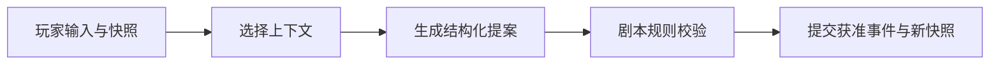
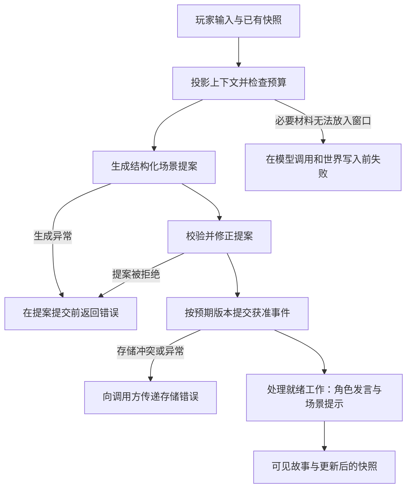
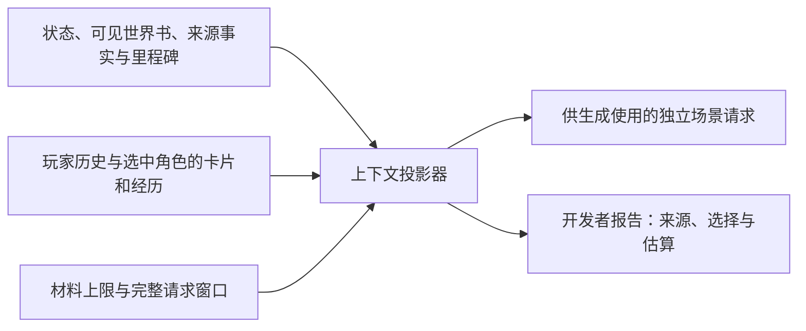

# StoryLoop Harness

**中文** | [English](README.en.md)

把玩家的自由输入变成场景叙述和可持续更新的世界状态。StoryLoop Harness 是独立的 Python 互动叙事运行时，适合开发叙事应用、命令行故事或生成实验的开发者。

- **选择上下文**：按玩家与角色视角组装相关故事素材。
- **校验世界变化**：生成提案经过剧本规则检查，再提交获准事件。
- **检查生成依据**：预览请求与来源、选择、裁剪和预算报告。

[快速开始](#快速开始) · [港口剧本](examples/freeform) · [反馈问题](https://github.com/storyloop0/storyloop-harness/issues) · [玩家与创作者界面：StoryLoop Platform](https://github.com/storyloop0/storyloop-platform)

## 先看一个回合

下面是 `examples/offline_turn.py` 对输入 `Hello` 的实际终端输出。它使用确定性模型，无需密钥、不请求模型服务，也不产生模型服务费用；用于检查运行流程，不代表真实模型的叙事质量。

```text
The dockhand coils a rope and waves you toward the arriving boat.

【码头工】
The morning boat has arrived.
Snapshot version: 2
```

## 快速开始

需要 **Python 3.12+** 和 Git。按你的系统运行以下命令；macOS / Linux 的 `python3` 需为 3.12 或更高版本。成功时终端显示上面的故事和 `Snapshot version: 2`。

**Windows PowerShell**

```powershell
git clone https://github.com/storyloop0/storyloop-harness.git
cd storyloop-harness
py -3.12 -m venv .venv
.\.venv\Scripts\python.exe -m pip install .
.\.venv\Scripts\python.exe examples/offline_turn.py
```

**macOS / Linux**

```sh
git clone https://github.com/storyloop0/storyloop-harness.git
cd storyloop-harness
python3 -m venv .venv
.venv/bin/python -m pip install .
.venv/bin/python examples/offline_turn.py
```

下一步：修改[港口剧本](examples/freeform)的故事素材，或展开下方参考接入自己的模型与存储。需要浏览器中的玩家与创作者界面，请使用 [StoryLoop Platform](https://github.com/storyloop0/storyloop-platform)。

## 运行时如何工作



生成的叙述不自动成为世界事实。Harness 负责上下文、生成、校验和事件执行；你的应用提供模型凭据、持久存储和价格策略。`TurnEngine.project_context` 可在不调用模型、不写入存储的情况下检查请求。

**状态：** 持续孵化中 · MIT。API、配置和存档格式可能直接调整，不保证兼容或迁移。角色视角不是秘密的硬隔离；持久化与跨进程协调需要调用方实现，整个回合不保证原子事务。

## 反馈与参与

遇到问题或有使用建议，请到 [Issues](https://github.com/storyloop0/storyloop-harness/issues) 提供版本或提交号、操作系统、最小复现与去除密钥的错误信息。想贡献代码，可从港口示例或现有 Issue 入手，在 PR 中说明行为变化和验证结果。开发命令见下方参考。

<details>
<summary>开发者参考：接入、上下文预算与执行边界</summary>

### 使用回合 API

安装后在仓库根目录运行：

```python
import asyncio
import sys

from storyloop_harness import ScenarioPackage, TurnEngine, TurnInput
from storyloop_harness.testing import InMemoryGameStore, OfflineModel


async def main():
    package = ScenarioPackage.load("examples/freeform")
    store = InMemoryGameStore()
    package.seed_game(store, "demo")
    engine = TurnEngine(store, package, OfflineModel())
    outcome = await engine.run_turn(
        TurnInput("demo", "Hello", "turn-1", package.version)
    )
    print(outcome.narration)
    print(outcome.snapshot.version)


if __name__ == "__main__":
    sys.stdout.reconfigure(encoding="utf-8")
    asyncio.run(main())
```

连接真实模型时提供 `ModelPort` 实现；`generation.CompatibleOpenAIChatModel` 适配器使用 AgentScope 2.0.9，凭据与路由由调用方提供。持久化游戏时实现 `GameStore` 及其预期版本提交契约。

## 检查上下文与配置预算

在仓库根目录运行：

```python
from storyloop_harness import ScenarioPackage, TurnEngine, TurnInput
from storyloop_harness.context import ContextBudget, ContextBudgetExceeded
from storyloop_harness.testing import InMemoryGameStore, OfflineModel

package = ScenarioPackage.load("examples/freeform")  # synthetic scenario
store = InMemoryGameStore()
package.seed_game(store, "inspection")
engine = TurnEngine(store, package, OfflineModel(), context_budget=ContextBudget(
    context_window_tokens=65536, output_tokens=4096,
    safety_margin_tokens=256, max_material_tokens=16000,
))
projection = engine.project_context(
    TurnInput("inspection", "Hello", "inspect-1", package.version)
)
print(projection.report.to_dict())
```

上例也是默认限制：完整请求窗口 65,536 Token，预留输出 4,096、安全余量 256，序列化材料另设 16,000 Token 上限。`utf8-conservative-v1` 使用字符/UTF-8 启发式估算，并非服务商的精确 Token 数。`scene-projection-v1` 计入系统提示词、消息封装与转义、展开后的输出 schema、传输余量、输出预留和安全余量。AgentScope 适配器在 HTTP 前检查 SDK 格式化后的请求，并发送一个有效的 `max_completion_tokens` 上限。自定义 `ModelPort` 必须遵守这个有界调用契约。

公开规则、来源解析、玩家输入、权威状态以及选中角色的非空身份信息属于必要内容。如果无法放入预算，`ContextBudgetExceeded` 携带不含来源正文的报告，在模型调用和世界写入前失败。修改后的检查请求会在生成时重新估算。该策略覆盖普通场景请求及每次传输尝试，不计量整局支出。

### 上下文选择规则参考

检查范围包括各接收者检查点之后的历史、最近四次玩家输入、最近六条玩家观察、可见世界书条目、公开/系统来源事实和里程碑候选，以及选中回复角色的私有卡片与历史。未选中角色的私有上下文和其他存档不在范围内。引擎使用自身的时钟、故事程序、回复角色上限和显式玩家偏好作用域。

`selected` 与 `truncated` 相互独立。`omission_reason` 记录排序/条数限制、字段裁剪（`field_limit`）或材料/窗口预算裁剪。来源事实与里程碑提示先于近期经历让出预算；从提示词中省略里程碑不会改变它的触发资格。

`testing.project_scene_request(store, package, game_id, player_text, context_budget=ContextBudget())` 使用同一投影器，仅返回独立请求；还接受 `clock`、`program` 和 `max_responders`。


## 集成接口参考

| 入口 | 用途 |
| --- | --- |
| 顶层包 | `ScenarioPackage`、`TurnEngine`、`TurnInput`、`TurnOutcome`、`GameStore`、`ModelPort`、`CampaignContext` |
| `contracts`、`ports` | 回合数据及模型/存储/故事程序协议 |
| `context` | `ContextBudget`、`ContextProjection`、`ProjectionReport`、`MaterialDecision`、`ContextBudgetExceeded` |
| `advanced` | 事件、工作与故事时钟契约 |
| `generation` | 结构化模型传输、格式化与动作建议 |
| `telemetry`、`usage` | 追踪与作用域内 Token 用量，不含价格策略 |
| `testing` | 内存存储、离线模型与独立请求检查 |

`run_turn` 接收 `TurnInput`，可选进度回调与故事时间上限；`run_ready_work` 处理支持的待办工作。`TurnOutcome` 包含可见输出、快照、本次调用提交的事件和模型用量。内部模块路径不属于扩展 API。

## 当前限制与开发

- 带有旧 `npc_reply` 待办的存档会在生成和世界写入前被拒绝，需要重建。
- 持久存储与跨进程协调需要调用方实现存储与应用层机制。
- 已存回合重放与预期版本提交，不代表端到端计费恢复或分布式执行保证。
- 长局记忆、可复现的质量/成本对照与更强的执行恢复仍是后续方向。

```sh
python -m pip install -e '.[test]' build
python -m pytest tests -q
python -m build --wheel
```

CI 还会在仓库外安装构建出的 wheel 并运行离线示例。确定性测试不能证明真实模型的叙事质量。

## 一个回合如何执行



普通 `single_call` 回合采用一次结构化场景生成阶段，再执行确定性工作。传输重试和其他定时生成任务可能产生额外模型请求。角色回复一起生成，通过 `single_npc_reply` 工作交付；每个角色没有独立的 ReAct 循环。

校验会筛选目标、回复和里程碑，也会把无效的开放动作效果改成尚未确认结果的尝试。预设动作由剧本规则裁决效果。状态变化仍是提案，调用方可通过 `proposed_status` 读取并结算。存储异常或后续工作失败需要调用方处理；整个回合并不保证是一个原子事务。

## 可以检查的上下文



`TurnEngine.project_context` 同步预览普通场景请求，不调用模型、不写入存储。角色视角有各自的历史与选择规则，但共享模型会看到多个角色的上下文，因此不能保证角色秘密的硬隔离。

独立请求包含故事素材；不可变报告包含来源 ID、归属、状态/检查点版本、字段、选择/裁剪原因与大小估算，不包含来源正文。两者都应留在开发者侧。报告不会进入玩家回合输出或故事事件；默认遥测只记录汇总数量与估算值。


</details>

## 许可证

[MIT](LICENSE)。
